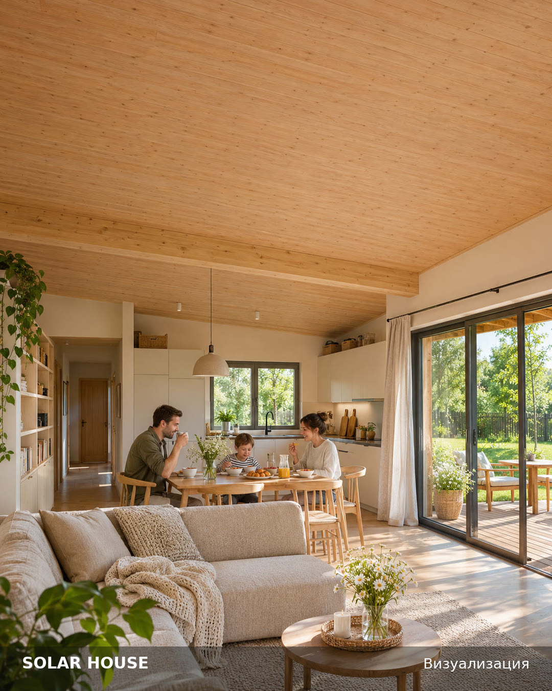
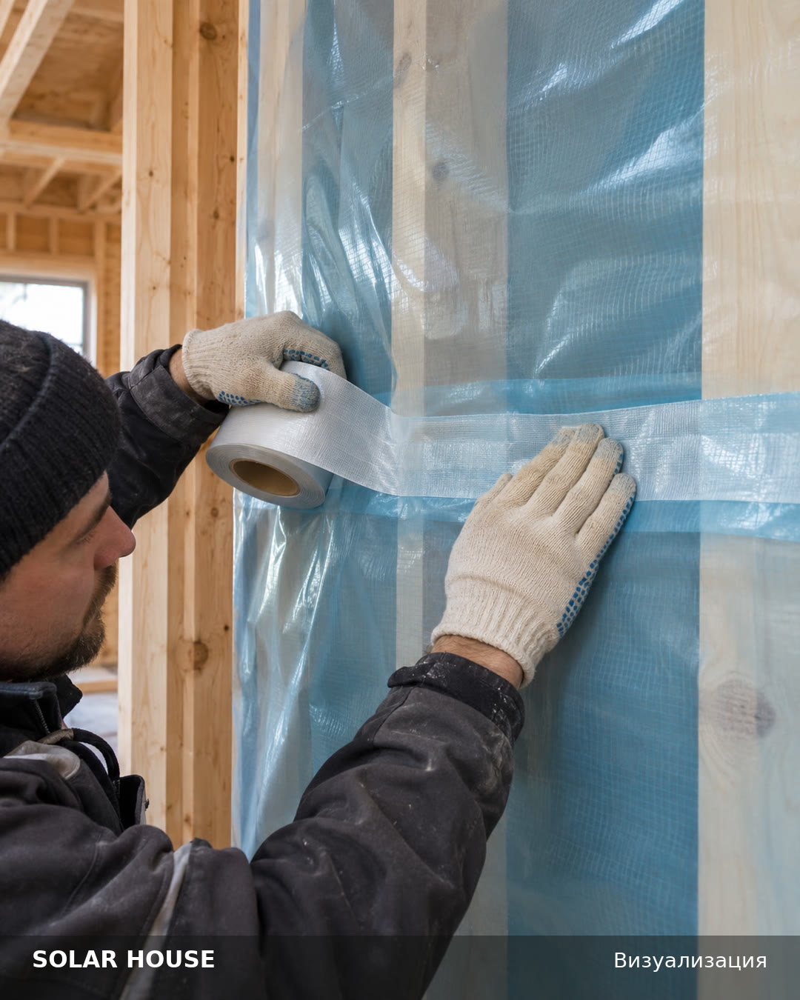
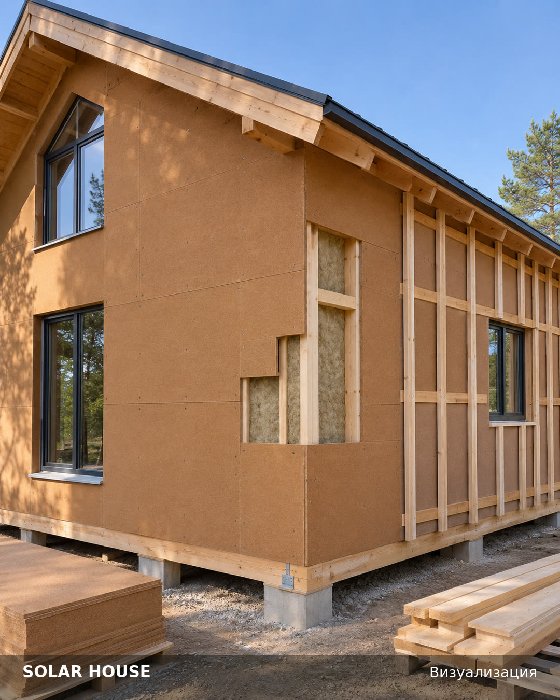
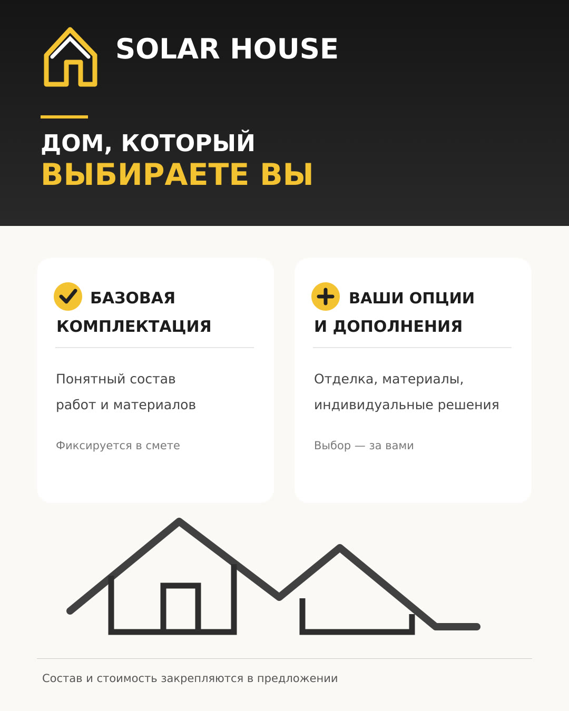

# Solar House — статьи на согласование, 20–26 ноября 2026

**Четыре поста с иллюстрациями. Клипов и автоматических историй нет.**

**СТАТУС на 20.11.2026:** 20.11 — утверждён и находится в очереди; 22.11 — ждём видео ошибки; 24.11 и 26.11 — утверждены и внесены в очередь, ждут загрузки изображений. Видео и истории не публикуются автоматически.

| Дата (10:00 МСК) | Статья | Статус | Иллюстрация |
|---|---|---|---|
| 2026-11-20 | Дом для семьи: сначала жизнь, потом метры | Утверждён, в очереди | [Открыть](2026-11-20-family-home.jpg) |
| 2026-11-22 | Пароизоляция: где прячутся ошибки | Ожидаем видео для финальной редакции | [Открыть](2026-11-22-vapor-barrier.jpg) |
| 2026-11-24 | МДВП: без перекрёстного утепления? | Утверждён, в очереди; фото ещё не загружено | [Открыть](2026-11-24-wood-fibreboard.jpg) |
| 2026-11-26 | Базовая комплектация + ваши решения | Утверждён, в очереди; фото ещё не загружено | [Открыть](2026-11-26-base-options.jpg) |

## 2026-11-20 — Дом для семьи: сначала жизнь, потом метры

🏡 ДОМ ДЛЯ СЕМЬИ: СКОЛЬКО НУЖНО КОМНАТ?

Есть соблазн выбирать дом по площади: 80, 100, 120 м²… Но начинать лучше с другого вопроса: как именно вы будете в нём жить?

Представим семью из трёх человек. Утром все собираются на кухне, днём кому-то нужно поработать в тишине, а вечером хочется проводить время вместе. У такой семьи могут быть совершенно разные требования к планировке — даже при одинаковой площади дома.

На что мы советуем обратить внимание:
✅ достаточное количество отдельных спален;
✅ место для хранения, которое не съест гостиную;
✅ удобный маршрут от входа до кухни;
✅ размеры санузла и технической зоны;
✅ связь кухни-гостиной с террасой и участком.

Большая площадь сама по себе не гарантирует удобства. Иногда продуманная планировка работает лучше лишних квадратных метров.

А вы бы выбрали компактный дом с большой гостиной или дополнительные отдельные комнаты? Напишите в комментариях.

#SolarHouse #ПланировкаДома #КаркасныйДом #НижнийНовгород

*Визуализация, не фотография конкретного построенного объекта Solar House.*

---

## 2026-11-22 — Пароизоляция: где прячутся ошибки

🔍 КАРКАСНЫЙ ДОМ: ОДНА ПЛЁНКА — МНОГО НЮАНСОВ

Пароизоляцию иногда воспринимают как второстепенный материал: прикрепили степлером — и достаточно. Но задача не сводится к наличию плёнки. Важна непрерывность и герметичность внутреннего защитного слоя.

Три момента, которые стоит проверить:
1️⃣ Нахлёсты полотен. Стыковать их впритык нельзя; величина нахлёста определяется инструкцией выбранного материала.
2️⃣ Проклейка соединений. Для стыков используют совместимые герметизирующие ленты, а не случайный бытовой скотч.
3️⃣ Примыкания и проходы коммуникаций. Розетки, трубы, углы и переходы между конструкциями требуют отдельного внимания.

Ошибки могут остаться за внутренней отделкой, поэтому качество монтажа проверяют до её закрытия.

В Solar House мы считаем, что важны не только материалы, но и аккуратность каждого узла.

Хотите отдельный разбор правильного пирога каркасной стены? Напишите «СТЕНА».

#SolarHouse #Пароизоляция #КаркаснаяТехнология #СтроительствоДома

*Иллюстративное изображение; монтаж выполняется по проекту и инструкции конкретной системы материалов.*

---

## 2026-11-24 — МДВП: когда можно обойтись без перекрёстного утепления

🌲 **МДВП: ПОЧЕМУ НЕ ВСЕГДА НУЖНО ПЕРЕКРЁСТНОЕ УТЕПЛЕНИЕ?**

В каркасном доме тепло уходит не только через утеплитель, но и через деревянные стойки. Поэтому один из распространённых приёмов — дополнительный перекрёстный слой утепления, который помогает уменьшить влияние так называемых мостиков холода.

Но есть и другое решение: сплошной наружный слой подходящей мягкой древесноволокнистой плиты (МДВП).

Например, в одной из применяемых Solar House схем мы используем:

✅ стойки каркаса глубиной 200 мм;
✅ 200 мм утеплителя между стойками;
✅ наружный слой МДВП, подобранный под конструкцию стены.

Что это даёт? Наружная плита добавляет теплоизоляцию, помогает уменьшить теплопотери через стойки и при правильно выполненной системе стыков снижает продувание. Поэтому при подтверждённом теплотехническом расчёте отдельный перекрёстный слой утепления в такой стене может не понадобиться.

⚠️ **Но сама по себе надпись «МДВП» не гарантирует результат.** Важны марка и толщина плиты, характеристики утеплителя, герметичность, влажностный режим, конструкция фасада и вентиляционные зазоры. Решение принимается для конкретного проекта.

Наш подход простой: каждый слой стены должен решать понятную задачу, а не просто увеличивать количество материалов в смете.

Хотите увидеть схему такой стены по слоям? Напишите «СТЕНА» — подготовим разбор.

#SolarHouse #МДВП #КаркасныйДом #УтеплениеДома

*Иллюстрация, не монтажная инструкция. Состав стены определяется расчётом и инструкциями выбранных материалов.*

---

## 2026-11-26 — Базовая комплектация + ваши решения

🏡 ДОМ, КОТОРЫЙ ВЫБИРАЕТЕ ВЫ

Мы за понятный подход к комплектациям: сначала обсуждаем базовый состав работ и материалов, затем отдельно — дополнительные решения под задачи семьи.

Например, на выбор могут влиять:
🔸 вид фасадной отделки;
🔸 тип кровельного покрытия;
🔸 варианты внутренней отделки;
🔸 дополнительное оборудование и инженерные решения.

Почему это удобно? Вы видите, что входит в первоначальный расчёт, а что добавляется по желанию. Можно сравнить решения и осознанно расставить приоритеты — по комфорту, внешнему виду и бюджету.

При этом конкретный состав базовой комплектации и стоимость каждой опции мы фиксируем в индивидуальном предложении. Никаких «от» без пояснений.

Напишите «КОМПЛЕКТАЦИЯ» в сообщения сообщества — обсудим, что нужно именно вашему дому.

#SolarHouse #КомплектацияДома #СтроительствоПодКлюч

*Иллюстрация комплектаций без конкретных цен; условия уточняются индивидуально.*

---

