# Solar House — на согласование: 20–26 ноября 2026

**СТАТУС: НЕ СОГЛАСОВАНО — ничего из этого пакета не публикуется.**

Семь публикаций на 10:00 МСК и семь анонсов-историй на 10:15 МСК. Иллюстрации и ролики созданы в качестве превью; музыку и финальные настройки клипов утвердим отдельно.

| Дата | Формат | Тема | Превью |
|---|---|---|---|
| 2026-11-20 | Пост с изображением | Дом для семьи: сначала жизнь, потом метры | [Открыть](2026-11-20-family-home.jpg) |
| 2026-11-21 | Клип 9 с | Сэкономили на проекте | [Открыть](2026-11-21-clip-preview.mp4) |
| 2026-11-22 | Пост с изображением | Пароизоляция: где прячутся ошибки | [Открыть](2026-11-22-vapor-barrier.jpg) |
| 2026-11-23 | Клип 9 с | Большая кухня-гостиная: место встречи | [Открыть](2026-11-23-clip-preview.mp4) |
| 2026-11-24 | Пост с изображением | МДВП: не просто плита снаружи | [Открыть](2026-11-24-wood-fibreboard.jpg) |
| 2026-11-25 | Клип 12 с | Дом за пять недель? Давайте честно | [Открыть](2026-11-25-clip-preview.mp4) |
| 2026-11-26 | Пост с изображением | Базовая комплектация + ваши решения | [Открыть](2026-11-26-base-options.jpg) |

## 2026-11-20 — Дом для семьи: сначала жизнь, потом метры

**Формат:** пост + изображение. **Согласование:** ожидается.

### Текст публикации

🏡 ДОМ ДЛЯ СЕМЬИ: СКОЛЬКО НУЖНО КОМНАТ?

Есть соблазн выбирать дом по площади: 80, 100, 120 м²… Но начинать лучше с другого вопроса: как именно вы будете в нём жить?

Представим семью из трёх человек. Утром все собираются на кухне, днём кому-то нужно поработать в тишине, а вечером хочется проводить время вместе. У такой семьи могут быть совершенно разные требования к планировке — даже при одинаковой площади дома.

На что мы советуем обратить внимание:
✅ достаточное количество отдельных спален;
✅ место для хранения, которое не съест гостиную;
✅ удобный маршрут от входа до кухни;
✅ размеры санузла и технической зоны;
✅ связь кухни-гостиной с террасой и участком.

Большая площадь сама по себе не гарантирует удобства. Иногда продуманная планировка работает лучше лишних квадратных метров.

А вы бы выбрали компактный дом с большой гостиной или дополнительные отдельные комнаты? Напишите в комментариях.

#SolarHouse #ПланировкаДома #КаркасныйДом #НижнийНовгород

### Визуал

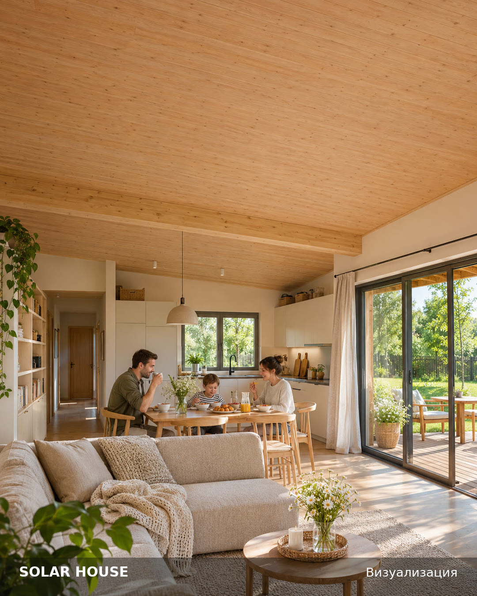

Атмосферная фотореалистичная иллюстрация: современная тёплая кухня-гостиная загородного каркасного дома, семья из трёх человек за завтраком, широкий общий план с видимой зоной хранения и дверью на террасу. Изображение не выдавать за построенный Solar House дом.

### История на 10:15

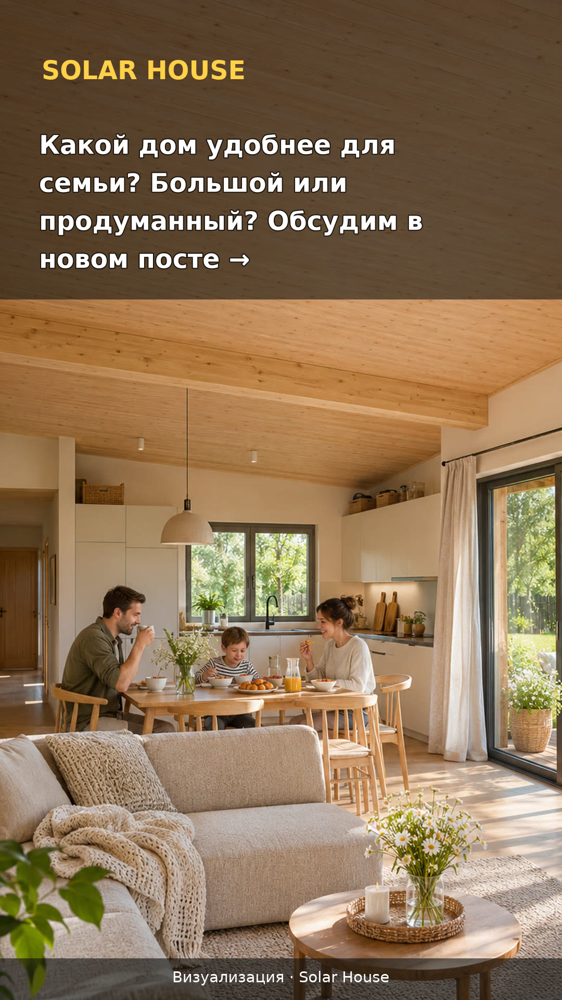

Какой дом удобнее для семьи? 🏡
Большой или продуманный?
Обсудим в новом посте →

*Визуализация, не фотография конкретного построенного объекта Solar House.*

---

## 2026-11-21 — Сэкономили на проекте

**Формат:** клип 9 секунд. **Согласование:** ожидается.

### Текст публикации

«Да зачем нам проект? Разберёмся по ходу!» 😅

А потом внезапно выясняется, что лестница не помещается, дверь конфликтует с мебелью, а розетку запланировали как раз за шкафом.

Это шуточный ролик, но смысл серьёзный: проект и продуманная планировка помогают заранее увидеть неудобные решения и уменьшить риск переделок.

Какая ошибка планировки раздражала бы вас больше всего?

Кадры постановочные/сгенерированные, не демонстрируют реальный объект или дефекты Solar House.

#SolarHouse #ПроектДома #СтроительныйЮмор

### Визуал

[▶ Посмотреть клип](2026-11-21-clip-preview.mp4)

9-секундный вертикальный клип, 3 сцены по 3 секунды, тёплая реалистичная стилистика; лёгкий юмор, без использования чужих логотипов.

### Раскадровка

1. **3 с:** «ПРОЕКТ? ЗАЧЕМ ПЛАТИТЬ?» — Улыбающийся персонаж демонстративно откладывает аккуратный план дома; ироничное начало.
2. **3 с:** «А ЛЕСТНИЦА ГДЕ БУДЕТ? 😳» — Комичный эпизод с планировкой на столе: лестница конфликтует с мебелью, без нелепых и физически невозможных конструкций.
3. **3 с:** «ПРОДУМАТЬ ДЕШЕВЛЕ, ЧЕМ ПЕРЕДЕЛАТЬ» — Профессионально разложенная планировка и уютный интерьер; спокойная завершающая сцена.

### История на 10:15

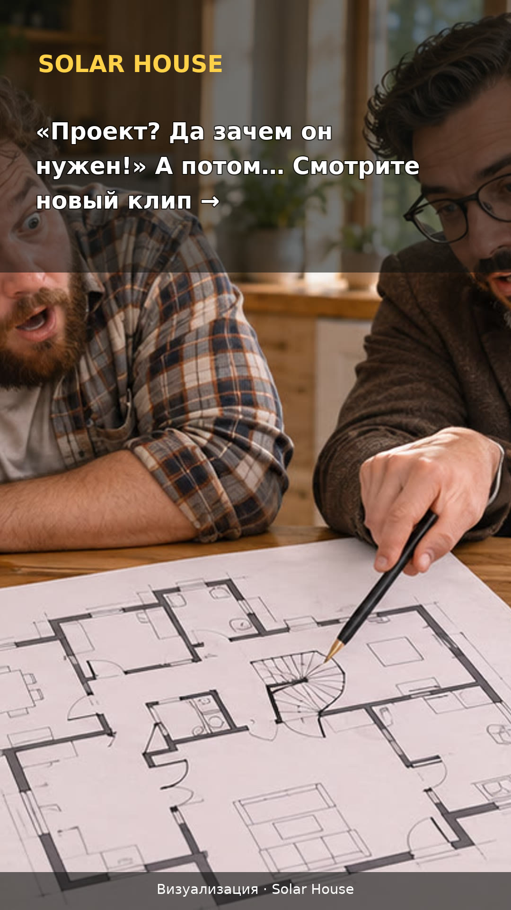

«Проект? Да зачем он нужен!» 😅
А потом…
Смотрите новый клип →

*Видеоряд — иллюстрация, не съёмка объекта Solar House.*

---

## 2026-11-22 — Пароизоляция: где прячутся ошибки

**Формат:** пост + изображение. **Согласование:** ожидается.

### Текст публикации

🔍 КАРКАСНЫЙ ДОМ: ОДНА ПЛЁНКА — МНОГО НЮАНСОВ

Пароизоляцию иногда воспринимают как второстепенный материал: прикрепили степлером — и достаточно. Но задача не сводится к наличию плёнки. Важна непрерывность и герметичность внутреннего защитного слоя.

Три момента, которые стоит проверить:
1️⃣ Нахлёсты полотен. Стыковать их впритык нельзя; величина нахлёста определяется инструкцией выбранного материала.
2️⃣ Проклейка соединений. Для стыков используют совместимые герметизирующие ленты, а не случайный бытовой скотч.
3️⃣ Примыкания и проходы коммуникаций. Розетки, трубы, углы и переходы между конструкциями требуют отдельного внимания.

Ошибки могут остаться за внутренней отделкой, поэтому качество монтажа проверяют до её закрытия.

В Solar House мы считаем, что важны не только материалы, но и аккуратность каждого узла.

Хотите отдельный разбор правильного пирога каркасной стены? Напишите «СТЕНА».

#SolarHouse #Пароизоляция #КаркаснаяТехнология #СтроительствоДома

### Визуал

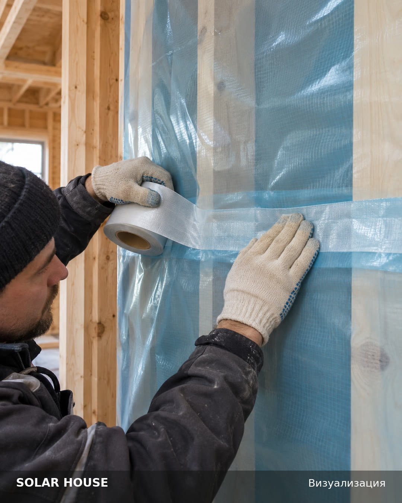

Реалистичное крупное фото аккуратно проклеенного шва пароизоляционной плёнки с видимым деревянным каркасом на стройплощадке, без вымышленных технических надписей, без скотча на повреждённых участках. Для иллюстрации, не техническая монтажная инструкция.

### История на 10:15

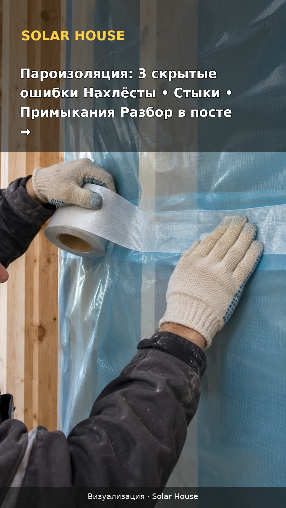

Пароизоляция: 3 скрытые ошибки ❌
Нахлёсты • Стыки • Примыкания
Разбор в посте →

*Иллюстративное изображение; монтаж выполняется по проекту и инструкции конкретной системы материалов.*

---

## 2026-11-23 — Большая кухня-гостиная: место встречи

**Формат:** клип 9 секунд. **Согласование:** ожидается.

### Текст публикации

Когда-то мы говорили: «Главное — чтобы у каждого была своя комната». А потом собираемся всей семьёй… всё равно на кухне. 😄

Общая кухня-гостиная может стать центром загородного дома: готовим, общаемся, принимаем гостей и просто проводим время вместе. Главное — заранее продумать удобные проходы, зонирование и места хранения.

Что для вас важнее: просторная общая зона или ещё одна отдельная комната?

Видеоряд — визуализация, не съёмка построенного объекта Solar House.

#SolarHouse #КухняГостиная #ПланировкаДома

### Визуал

[▶ Посмотреть клип](2026-11-23-clip-preview.mp4)

9-секундный вертикальный ролик, 3 сцены по 3 секунды. Тёплый семейный юмор, просторный интерьер со светлым деревом и видом на участок.

### Раскадровка

1. **3 с:** «У ВСЕХ ЕСТЬ СВОИ КОМНАТЫ…» — Три уютные отдельные комнаты пустые; ироничное ожидание.
2. **3 с:** «НО ВСЕ СНОВА НА КУХНЕ 😄» — Семья и друзья общаются у большого стола современной кухни-гостиной.
3. **3 с:** «ВОТ ЗАЧЕМ НУЖНА КУХНЯ-ГОСТИНАЯ» — Красивый широкий вид на единое пространство с выходом на террасу.

### История на 10:15

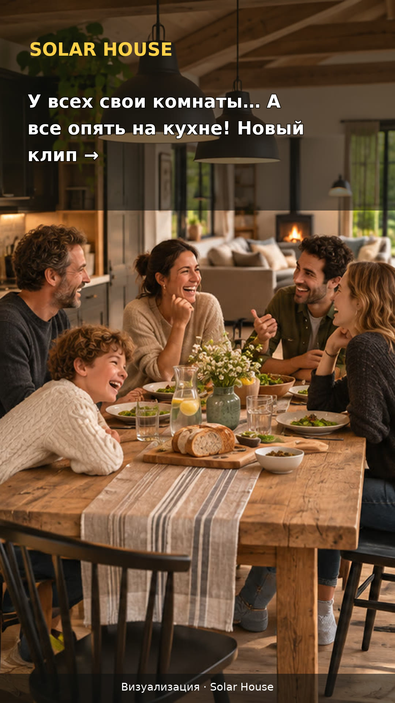

У всех свои комнаты…
А все опять на кухне! 😄
Новый клип →

*Видеоряд — визуализация, не фотография построенного Solar House объекта.*

---

## 2026-11-24 — МДВП: не просто плита снаружи

**Формат:** пост + изображение. **Согласование:** ожидается.

### Текст публикации

🌲 МДВП: ЗАЧЕМ ЕЁ СТАВЯТ СНАРУЖИ КАРКАСА?

Мягкая древесноволокнистая плита — один из вариантов дополнительного наружного слоя в каркасной стене. Но важно понимать: разные плиты выполняют разные задачи, поэтому материал подбирают под конкретную конструкцию.

Что может дать подходящая плита в правильно спроектированной системе:
✅ дополнительную теплоизоляцию;
✅ снижение продувания наружного слоя;
✅ возможность организовать паропроницаемую наружную часть стены.

Есть условия: нужно учитывать характеристики конкретной плиты, её назначение, толщину, крепёж, обработку стыков и устройство фасада. Сам факт наличия МДВП не заменяет правильный расчёт конструкции и не делает стену автоматически «идеальной».

В наших проектах состав стены зависит от выбранной комплектации и материалов. Мы объясняем, за что отвечает каждый слой, а не предлагаем загадочный «пирог».

Хотите, чтобы мы разобрали стену по слоям — от внутренней отделки до фасада?

#SolarHouse #МДВП #КаркасныйДом #УтеплениеДома

### Визуал

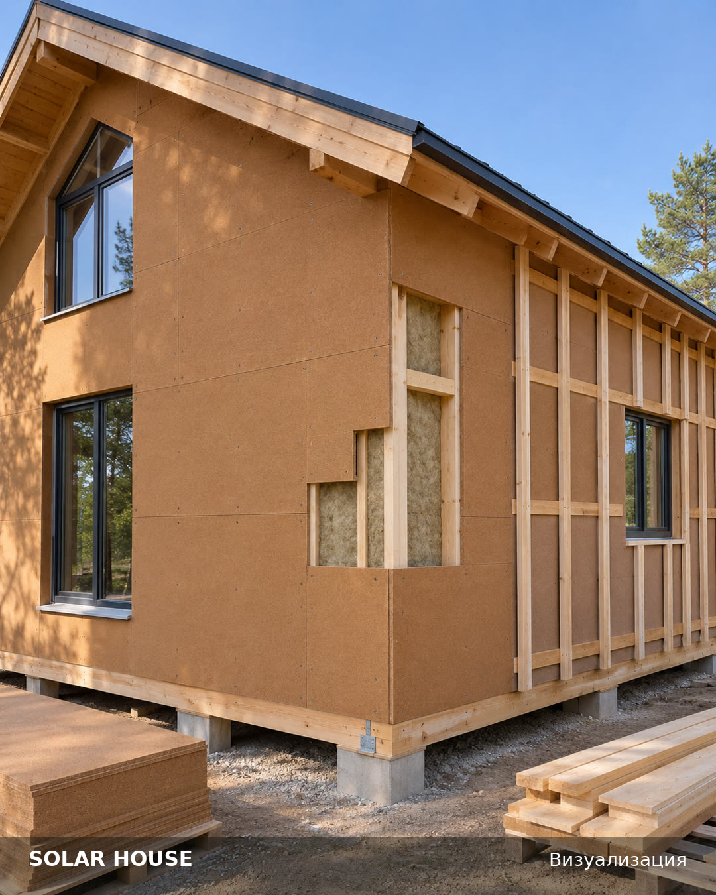

Фотореалистичный крупный план наружного угла каркасного дома в процессе сборки: на стене смонтированы ровные древесноволокнистые плиты, слева деревянный каркас и утеплитель, справа подготовленная вентфасадная подсистема; демонстрационный образец, не строительная инструкция.

### История на 10:15

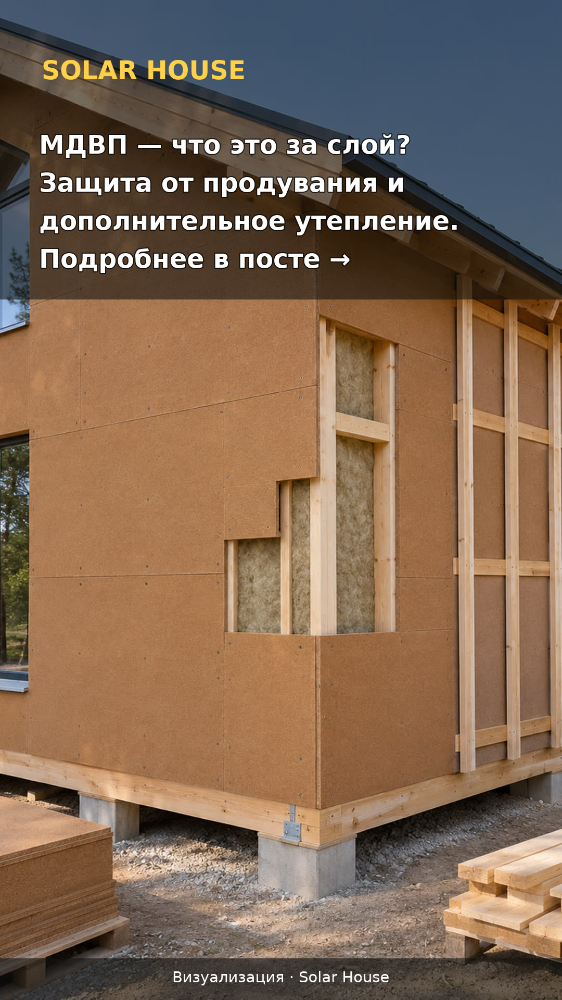

МДВП — что это за слой? 🌲
Защита от продувания и дополнительное утепление.
Подробнее в посте →

*Иллюстрация узла; монтаж и совместимость материалов — по проекту и инструкции производителя.*

---

## 2026-11-25 — Дом за пять недель? Давайте честно

**Формат:** клип 12 секунд. **Согласование:** ожидается.

### Текст публикации

«Можно построить дом за пять недель?» — один из вопросов, который нам задают. 🏠⏱️

Короткий ответ: для некоторых проектов и этапов работ такой срок возможен, но универсального обещания нет. На график влияют проект, выбранная комплектация, подготовка участка, поставки и погода.

Быстро — хорошо, если технология и качество не страдают. Обещать один срок всем домам было бы нечестно.

Хотите узнать реалистичный график для вашего проекта? Напишите в сообщения Solar House.

Кадры иллюстративные, не показывают фактическую скорость строительства конкретного объекта.

#SolarHouse #СрокиСтроительства #КаркасныйДом

### Визуал

[▶ Посмотреть клип](2026-11-25-clip-preview.mp4)

12-секундный вертикальный видеоролик, 3 сцены по 4 секунды; лёгкая динамика, визуализация без конкретной маркировки сроков этапов строительства.

### Раскадровка

1. **4 с:** «ДОМ ЗА 5 НЕДЕЛЬ? ⏱️» — Лист календаря рядом с красивым проектом дома, динамичное и ироничное начало.
2. **4 с:** «ЗАВИСИТ ОТ ПРОЕКТА И КОМПЛЕКТАЦИИ» — Последовательность ключевых стадий стройки на безопасном объекте, без нарушения реальных технологий.
3. **4 с:** «СРОКИ — ЧЕСТНО. КАЧЕСТВО — ОБЯЗАТЕЛЬНО.» — Готовый уютный загородный каркасный дом целиком и участок, светлый финал.

### История на 10:15

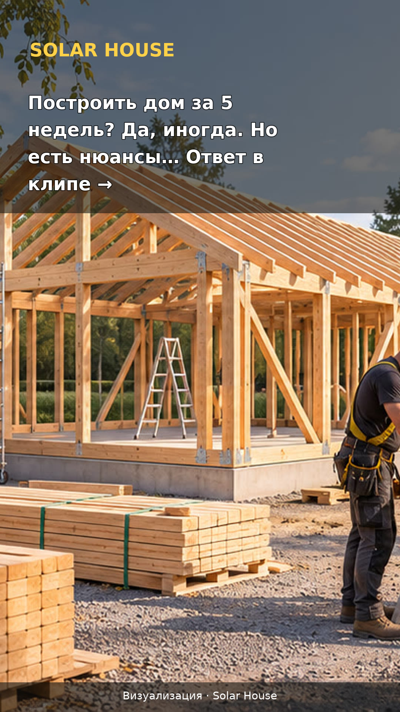

Построить дом за 5 недель? ⏱️
Да, иногда. Но есть нюансы…
Ответ в клипе →

*Сцены — визуализации, не хроника строительства объекта за 5 недель.*

---

## 2026-11-26 — Базовая комплектация + ваши решения

**Формат:** пост + изображение. **Согласование:** ожидается.

### Текст публикации

🏡 ДОМ, КОТОРЫЙ ВЫБИРАЕТЕ ВЫ

Мы за понятный подход к комплектациям: сначала обсуждаем базовый состав работ и материалов, затем отдельно — дополнительные решения под задачи семьи.

Например, на выбор могут влиять:
🔸 вид фасадной отделки;
🔸 тип кровельного покрытия;
🔸 варианты внутренней отделки;
🔸 дополнительное оборудование и инженерные решения.

Почему это удобно? Вы видите, что входит в первоначальный расчёт, а что добавляется по желанию. Можно сравнить решения и осознанно расставить приоритеты — по комфорту, внешнему виду и бюджету.

При этом конкретный состав базовой комплектации и стоимость каждой опции мы фиксируем в индивидуальном предложении. Никаких «от» без пояснений.

Напишите «КОМПЛЕКТАЦИЯ» в сообщения сообщества — обсудим, что нужно именно вашему дому.

#SolarHouse #КомплектацияДома #СтроительствоПодКлюч

### Визуал

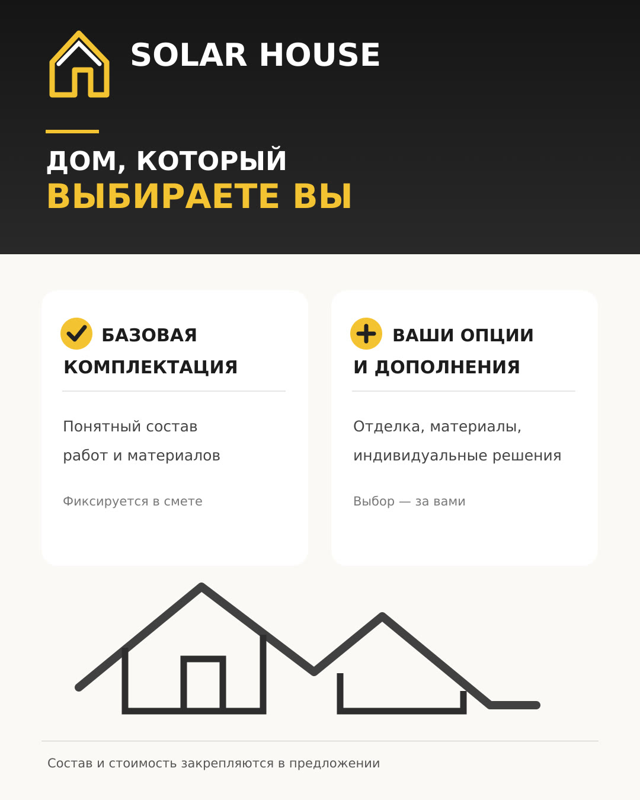

Чистая дизайнерская карточка 4:5 с двумя визуальными зонами: «БАЗА» и «ВАШИ ОПЦИИ». Внизу силуэт современного каркасного дома. Строго фирменный чёрный, тёплый белый и жёлтый, без конкретных цен и характеристик. Этот точный макет делать в SVG/HTML, не через генеративный рисунок.

### История на 10:15

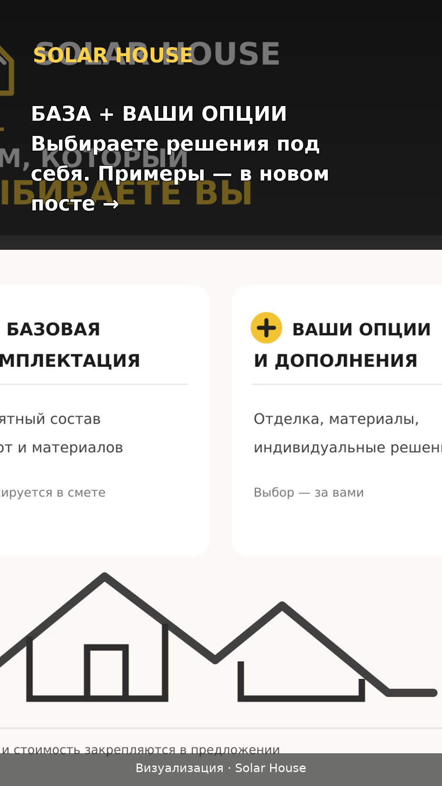

БАЗА + ВАШИ ОПЦИИ 🔧
Выбираете решения под себя.
Примеры — в новом посте →

*Иллюстрация комплектаций без конкретных цен; условия уточняются индивидуально.*

---

